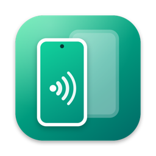

<p align="center">
  
</p>

<h1 align="center">Mirro</h1>

<p align="center">
  Duplica y controla tus teléfonos Android desde la barra de estado de tu Mac.
</p>

---

Mirro es una app nativa de macOS que vive en la barra de estado y te permite ver y usar la pantalla de tus dispositivos Android con un clic. Por debajo usa [scrcpy](https://github.com/Genymobile/scrcpy), que ya viene incluido: no hay que instalar nada más.

## Funciones

- **Un clic para duplicar** cualquier teléfono conectado, desde la barra de estado o desde la ventana principal
- **Varios dispositivos a la vez**, con «Duplicar todos» y «Detener todos»
- **USB o WiFi**: pasa un teléfono USB a WiFi automáticamente o conéctate por IP
- **Información del dispositivo**: modelo, marca, versión de Android y batería
- **Onboarding** que te guía para activar la depuración USB
- **Opciones**: apagar la pantalla del teléfono, mantenerlo despierto, sin audio, ventana siempre encima, mostrar toques y resolución máxima
- **Abrir al iniciar sesión**

## Instalación

### Recomendado: Terminal

```sh
curl -fsSL https://raw.githubusercontent.com/carlosmedina06/mirro/main/install.sh | bash
```

Descarga la última versión desde [Releases](https://github.com/carlosmedina06/mirro/releases/latest), verifica su checksum, la instala en `/Applications` y la abre. Puedes [leer el script](install.sh) antes de ejecutarlo. Para actualizar, vuelve a ejecutar el mismo comando.

Para desinstalar:

```sh
curl -fsSL https://raw.githubusercontent.com/carlosmedina06/mirro/main/install.sh | bash -s -- --uninstall
```

### Descarga directa

Descarga `Mirro-x.y.z.zip` desde [Releases](https://github.com/carlosmedina06/mirro/releases/latest), descomprímelo y mueve **Mirro.app** a `/Applications`.

> **Si usaste la descarga directa:** Mirro todavía no está notarizada por Apple, así que la primera vez macOS la bloquea con el aviso *«Apple no pudo verificar…»*. Intenta abrirla, cierra el aviso y ve a **Ajustes del Sistema › Privacidad y seguridad › Abrir igualmente**. O ejecuta `xattr -dr com.apple.quarantine /Applications/Mirro.app`. Solo hace falta una vez. Con el instalador de Terminal no ocurre.

## Requisitos

- macOS 13 Ventura o posterior
- Mac con Apple Silicon o Intel
- Un teléfono Android con la **depuración USB** activada (Mirro te explica cómo)

Si ya tienes `adb` instalado (por ejemplo, con Android Studio), Mirro usa ese para no interferir con tus herramientas. Si no, usa el que trae incluido.

## Compilar desde el código

Solo necesitas las Command Line Tools de Xcode (`xcode-select --install`).

```sh
git clone https://github.com/carlosmedina06/mirro.git
cd mirro
./build.sh            # genera build/Mirro.app
./build.sh --install  # además la copia a /Applications
```

`build.sh` descarga la build oficial de scrcpy para macOS y verifica su SHA-256 antes de empaquetarla.

### Estructura

| Archivo | Qué hace |
| --- | --- |
| `Sources/main.swift` | Barra de estado y ventana |
| `Sources/Model.swift` | Estado compartido, sesiones de scrcpy |
| `Sources/Views.swift` | Interfaz en SwiftUI |
| `Sources/Tools.swift` | Llamadas a adb |
| `Sources/StatusIcon.swift` | Icono de la barra de estado |
| `Tools/make-icon.swift` | Genera el icono de la app |
| `release.sh` | Crea el `.zip` del release y su checksum |
| `install.sh` | Instalador de una línea |

## Créditos

Mirro no sería posible sin [**scrcpy**](https://github.com/Genymobile/scrcpy) de Genymobile y Romain Vimont, que se distribuye dentro de la app sin modificaciones bajo la [licencia Apache 2.0](https://github.com/Genymobile/scrcpy/blob/master/LICENSE). También incluye `adb` de [Android Platform Tools](https://developer.android.com/tools/releases/platform-tools).

Mirro no está afiliada a Genymobile ni a Google. Android es una marca de Google LLC.

## Licencia

[MIT](LICENSE) © Carlos Medina
